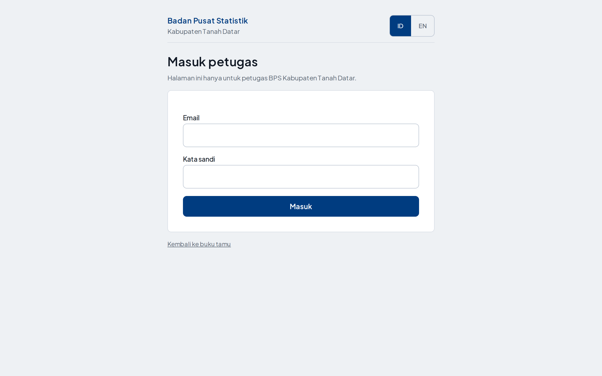
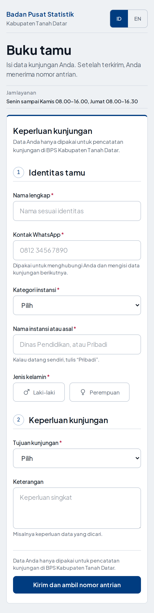
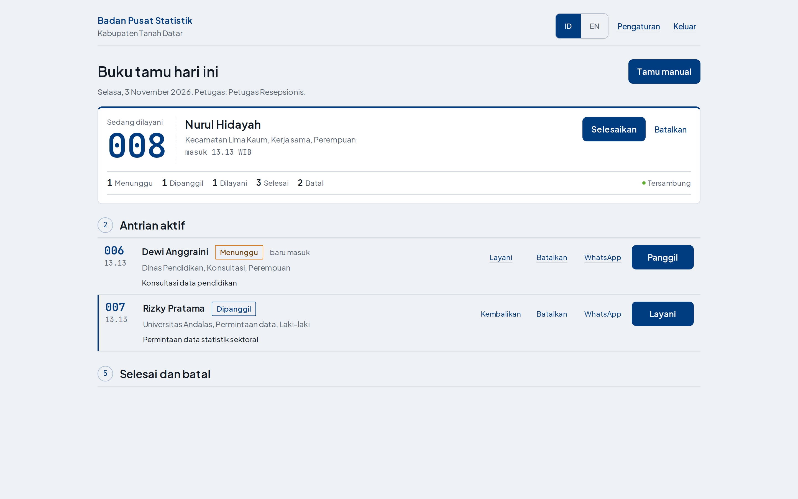
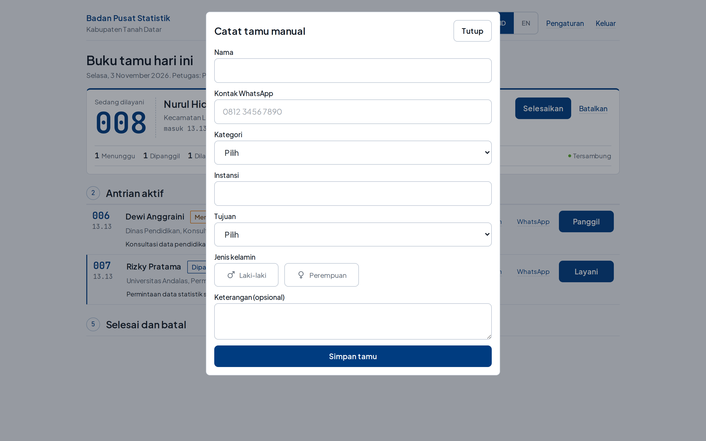
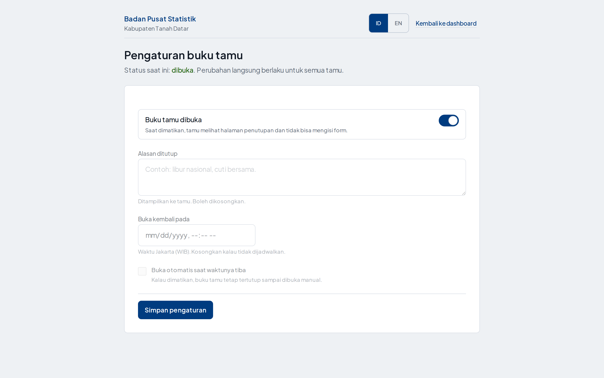

# Panduan Petugas — Buku Tamu Digital

**BPS Kabupaten Tanah Datar**
Versi demo · 3 November 2026

Panduan ini untuk petugas resepsionis yang memakai aplikasi setiap hari.
Tidak perlu pengetahuan teknis. Semua tombol dijelaskan sesuai yang terlihat di layar.

Alamat aplikasi: **https://bukutamu.grrifixn.my.id**

---

## 1. Ringkasan satu menit

- Tamu mengisi form sendiri dari HP → dapat **nomor antrian** → otomatis muncul di dashboard petugas.
- Petugas memakai satu layar: **Dashboard** (`/dashboard`) untuk memanggil, melayani, dan menyelesaikan.
- Tamu yang tidak punya HP / tidak mau mengisi sendiri dicatat lewat tombol **Tamu manual**.
- Kalau kantor tutup atau sedang tidak menerima tamu, buku tamu **ditutup** dari halaman **Pengaturan**.
- Nomor antrian dimulai dari **001 setiap hari** dan kembali ke 001 besok pagi.

---

## 2. Masuk dan keluar

**Masuk**

1. Buka https://bukutamu.grrifixn.my.id/masuk
2. Isi email petugas dan kata sandi.
3. Tekan **Masuk** → langsung dibawa ke dashboard.

Akun demo: `petugas@bps-tanahdatar.go.id`
Kata sandi diberikan oleh pengelola aplikasi. **Jangan ditempel di meja** dan jangan dibagikan ke tamu.

**Keluar**

Tekan tombol **Keluar** di kanan atas dashboard. Lakukan setiap akhir shift, terutama kalau komputer dipakai bergantian.

**Kalau lupa kata sandi:** hubungi pengelola aplikasi (admin Supabase). Tidak ada tombol "lupa sandi" di halaman masuk.

---

## 3. Apa yang terjadi saat tamu mengisi form

1. Tamu membuka beranda dan mengisi: nama, kontak WhatsApp, kategori instansi, nama instansi, tujuan kunjungan, jenis kelamin, dan keterangan (opsional).
2. Tamu menekan **Kirim dan ambil nomor antrian**.
3. Tamu mendapat halaman **Tiket kunjungan** berisi nomor antrian, nama, instansi, jenis kelamin, dan waktu daftar. Tiket bisa disimpan ke WhatsApp atau dicetak sendiri.
4. Baris tamu **muncul sendiri di dashboard** tanpa perlu refresh.

Nomor antrian bentuknya urutan harian: **001, 002, 003, …**
Di dalam database nomor disimpan lengkap sebagai `BT-20261103-001`, tetapi yang ditampilkan dan dipanggil cukup tiga angka terakhir.

---

## 4. Mengenal dashboard

Dashboard disusun dari atas ke bawah, mengikuti urutan kerja meja resepsionis.

**Papan meja (paling atas)**

Kotak besar di atas adalah meja yang sedang dilayani — bukan grafik statistik.
Yang tampil di situ:

- **Nomor antrian besar** tamu yang sedang dilayani atau baru dipanggil, lengkap
  dengan nama, asal, tujuan, dan satu tombol besar sesuai langkah berikutnya
  (Layani / Selesaikan).
- Kalau belum ada yang dilayani tetapi ada yang menunggu: tulisan **Berikutnya**
  + nomor + sudah berapa lama menunggu + tombol **Panggil berikutnya**.
- Kalau tidak ada tamu sama sekali: **Meja kosong**. Tidak ada yang perlu ditekan.

Di bawah papan ada **garis hitung**: Menunggu · Dipanggil · Dilayani · Selesai ·
Batal, dan di ujung kanan penanda sambungan.

**Baris atas layar**

- **Tersambung** (titik hijau) — sambungan langsung ke server aktif. Kalau berubah
  jadi **Menyambung ulang**, daftar tidak akan bertambah otomatis sampai tersambung
  lagi; aksi tetap bisa ditekan.
- **Tamu manual** — mencatat tamu yang datang langsung.
- **Pengaturan** — membuka atau menutup buku tamu.
- **Keluar** — mengakhiri sesi petugas.

**Daftar tamu**

Ada dua bagian:

1. **Antrian aktif** — tamu yang belum selesai (Menunggu, Dipanggil, Dilayani).
   Urutannya nomor antrian dari kecil ke besar.
2. **Selesai dan batal** — terlipat di bawah. Klik untuk membuka. Tamu yang sudah
   beres tidak menenggelamkan antrian yang masih jalan.

Tiap baris berisi: nomor · nama · label status · instansi, tujuan, jenis kelamin ·
jam masuk · keterangan (kalau diisi) · tombol aksi · tautan **WhatsApp**.
Tulisan **"dicatat petugas"** berarti entri itu dibuat lewat tombol Tamu manual.

**Penomoran halaman**

Daftar menampilkan **5 baris per halaman** supaya layar tidak penuh dan barisnya
tetap besar. Kalau tamunya lebih dari lima:

- Keterangan **"1–5 dari 12"** di kiri, tombol **Sebelumnya / Berikutnya** di kanan.
- Kalau ada tamu baru masuk, dashboard otomatis membuka halaman tempat tamu itu
  berada — petugas tidak perlu mencari.
- Kalau halaman yang sedang dibuka jadi kosong (misalnya semua tamunya baru saja
  diselesaikan), dashboard mundur sendiri ke halaman sebelumnya.

**Tombol aksi selalu segaris**

Tombol di tiap baris punya lebar yang sama walaupun tulisannya berbeda (Panggil,
Layani, Kembalikan, Selesaikan). Tombol biru utama selalu berada di posisi paling
kanan pada kolom yang sama, jadi mata tidak perlu mencari-cari setiap kali
membaca baris baru.

---

## 5. Tiga layar yang dipakai petugas

| Layar | Alamat | Dipakai untuk |
|---|---|---|
| Dashboard | `/dashboard` | Melihat daftar tamu hari ini, memanggil, melayani, menyelesaikan, membatalkan |
| Pengaturan | `/pengaturan` | Menutup atau membuka buku tamu, mengisi alasan dan jadwal buka kembali |
| Masuk | `/masuk` | Login petugas (hanya kalau sesi habis atau ganti shift) |

Halaman tamu (`/` dan `/t/...`) tidak perlu dibuka petugas — itu untuk tamu.

---

## 6. Alur status tamu

Status hanya bisa maju sesuai urutan. Tombol yang muncul di tiap baris menyesuaikan status saat ini, jadi petugas tidak perlu menghafal.

| Status sekarang | Tombol yang tersedia | Artinya |
|---|---|---|
| **Menunggu** | Panggil · Layani · Batalkan | Tamu sudah dapat nomor, belum dipanggil |
| **Dipanggil** | Layani · Kembalikan · Batalkan | Nomor sudah dipanggil; Kembalikan kalau tamu tidak datang dan antrian perlu diulang |
| **Dilayani** | Selesaikan · Batalkan | Tamu sedang/baru selesai dilayani |
| **Selesai** | — | Selesai, tidak bisa diubah lagi |
| **Batal** | — | Dibatalkan, tidak bisa diubah lagi |

Tombol utama (biru) adalah langkah paling wajar untuk status itu:

- Menunggu → **Panggil**
- Dipanggil → **Layani**
- Dilayani → **Selesaikan**

Tombol abu-abu di sebelahnya adalah pilihan lain (Kembalikan, Batalkan, atau lompat langsung ke Layani kalau tamu sudah berdiri di depan meja).

**Catatan penting:** Selesai dan Batal bersifat final. Kalau salah tekan, tidak ada tombol undo — perbaikan hanya bisa dilakukan lewat database oleh pengelola. Karena itu, biasakan menekan **Batalkan** hanya setelah yakin tamu memang tidak jadi dilayani.

---

## 7. Langkah harian petugas

**Pagi, sebelum menerima tamu**

1. Masuk ke dashboard.
2. Pastikan tertulis **Tersambung** (titik hijau), bukan Menyambung ulang.
3. Buka **Pengaturan** → pastikan status **dibuka**. Kalau kantor belum buka, lihat bagian 9.
4. Pastikan papan meja bertuliskan **Meja kosong** dan semua angka di garis hitung masih 0. Kalau ada sisa angka dari kemarin, hubungi pengelola.

**Setiap tamu datang**

1. Tamu mengisi form sendiri di HP (arahkan ke beranda kalau perlu).
2. Sebut nomornya setelah tamu selesai mengisi, atau panggil ketika giliran tiba: tekan **Panggil**.
3. Saat tamu menghadap: tekan **Layani**.
4. Setelah urusan selesai: tekan **Selesaikan**.
5. Tamu tidak datang saat dipanggil: tekan **Kembalikan** (kembali ke Menunggu) atau **Batalkan** kalau memang batal.

**Menghubungi tamu**

Tautan **WhatsApp** di tiap baris membuka chat langsung ke nomor tamu. Dipakai kalau tamu perlu dihubungi, bukan untuk mengirim tiket — tiket sudah dikirim tamu ke dirinya sendiri.

**Akhir hari**

1. Pastikan tidak ada tamu yang masih berstatus Menunggu atau Dipanggil. Selesaikan atau batalkan.
2. Kalau kantor sudah tutup, tutup buku tamu dari Pengaturan supaya tamu malam tidak mendapat nomor kosong.

---

## 8. Mencatat tamu manual

Dipakai kalau tamu: tidak membawa HP, HP-nya habis baterai, atau tidak mau mengisi sendiri.

1. Tekan **Tamu manual**.
2. Isi: nama · kontak WhatsApp · kategori instansi · nama instansi · tujuan kunjungan · jenis kelamin · keterangan (opsional).
3. Tekan **Simpan tamu**. Jendela tertutup dan tamu langsung masuk daftar paling bawah.

Yang perlu diketahui:

- Tamu manual **tetap mendapat nomor antrian** dari urutan yang sama, tidak melompat.
- Barisnya ditandai **"dicatat petugas"**.
- Tamu manual **tidak mendapat halaman tiket**. Nomornya dibaca dari daftar dashboard dan disebutkan langsung.
- Nomor WhatsApp wajib diisi karena dipakai untuk menghubungi tamu. Kalau tamu benar-benar tidak punya nomor, isi nomor kantor resepsionis dan tulis di keterangan.

---

## 9. Menutup dan membuka buku tamu

Dari **Pengaturan**:

- **Buku tamu dibuka** — sakelar utama. Matikan kalau kantor tutup, rapat, atau sedang tidak menerima tamu.
- **Alasan ditutup** — teks yang dibaca tamu di beranda. Contoh: "Libur nasional, buka kembali Senin". Boleh dikosongkan (akan memakai alasan bawaan).
- **Buka kembali pada** — tanggal dan jam (WIB) kapan buku tamu otomatis dibuka.
- **Buka otomatis saat waktunya tiba** — kalau menyala, aplikasi membuka sendiri pada waktu yang diisi di atas.
- Tekan **Simpan pengaturan**. Konfirmasi muncul: "Pengaturan tersimpan pukul HH.MM WIB".

Apa yang dilihat tamu saat ditutup:

- Beranda berubah menjadi halaman **Buku tamu ditutup** beserta alasannya.
- Form tidak muncul, jadi tidak ada nomor antrian baru.
- Tamu yang sudah punya nomor tetap bisa membuka tiketnya.

Apa yang terjadi pada petugas:

- Dashboard tetap bisa dibuka, data kemarin dan hari ini tetap ada.
- Petugas tetap bisa mengubah status tamu yang sudah tercatat.

**Kalau lupa membuka kembali:** aplikasi hanya membuka otomatis kalau waktu "Buka kembali pada" sudah lewat **dan** auto-buka menyala. Kalau dua syarat itu tidak terpenuhi, buku tamu tetap tertutup sampai dinyalakan manual.

---

## 10. Tombol bahasa (ID / EN)

Ada di kanan atas setiap halaman. Pilihan disimpan di browser, jadi tetap terpakai saat halaman dibuka lagi.

- **ID** — bahasa Indonesia (bawaan).
- **EN** — Inggris, untuk tamu asing atau petugas yang lebih nyaman berbahasa Inggris.

Perubahan bahasa tidak mengubah data. Status, nomor antrian, dan nama tamu tetap sama.

---

## 11. Kalau ada masalah

| Yang terlihat | Artinya | Yang dilakukan |
|---|---|---|
| **Menyambung ulang** (titik abu-abu) | Sambungan langsung terputus | Muat ulang halaman. Data tidak hilang. Aksi tetap bisa dilakukan, hanya daftar tidak bertambah sendiri |
| Tamu baru tidak muncul di daftar | Sambungan putus atau tamu belum menekan kirim | Cek indikator, muat ulang halaman, lalu cek di Supabase kalau masih ragu |
| **Sesi berakhir. Silakan masuk lagi** | Sesi login habis | Masuk lagi lewat `/masuk`. Pekerjaan yang belum disimpan perlu diulang |
| **Terlalu banyak percobaan. Coba lagi beberapa menit** | Satu alamat IP mengirim form terlalu sering (batas 3 pengisian per 30 detik; wifi kantor biasanya terhitung satu IP) | Tunggu beberapa menit, atau catat lewat **Tamu manual** (tidak terkena batas ini) |
| **Buku tamu sedang ditutup** | Sakelar di Pengaturan sedang mati | Buka dari Pengaturan |
| Buku tamu tertutup padahal jam kerja | Jadwal buka kembali salah atau auto-buka mati | Nyalakan sakelar **Buku tamu dibuka** secara manual |
| **Gagal mengubah status** | Sambungan ke server terputus saat menekan tombol | Muat ulang halaman, cek status terbaru, ulangi |
| Halaman kosong / putih | Gangguan saat memuat | Muat ulang; kalau tetap, laporkan ke pengelola |
| Data tamu salah ketik | Tidak ada fitur ubah data | Batalkan entri itu, lalu catat ulang lewat **Tamu manual** |

Kalau masalah berulang, catat: halaman apa, jam kejadian, dan tulisan galat yang muncul. Itu cukup untuk pengelola menelusuri.

---

## 12. Yang sebaiknya tidak dilakukan

- **Jangan** membagikan tautan dashboard atau akun petugas ke tamu atau grup WhatsApp.
- **Jangan** mengubah atau menghapus data langsung di database Supabase. Semua perubahan status sebaiknya dari dashboard supaya tercatat waktunya.
- **Jangan** menutup buku tamu tanpa mengisi alasan — tamu akan melihat alasan bawaan dan menghubungi kantor.
- **Jangan** mengandalkan dashboard sebagai satu-satunya arsip. Kalau perlu rekap bulanan, minta pengelola mengambil data dari database.
- **Jangan** menekan **Selesaikan** atau **Batalkan** sebelum urusan tamu benar-benar selesai — keduanya final.

---

## 13. Data tamu dan privasi

- Yang disimpan: nama, nomor WhatsApp, instansi, kategori instansi, tujuan, jenis kelamin, keterangan, waktu daftar.
- Data dipakai untuk keperluan buku tamu dan rekap kunjungan BPS.
- Halaman dashboard hanya bisa dibuka setelah login. Halaman tamu tidak menampilkan data tamu lain.
- Jangan menyebut nomor WhatsApp tamu di depan tamu lain.

---

## 14. Batas versi demo

Versi ini dipakai untuk uji coba di lingkungan BPS Kabupaten Tanah Datar, belum menjadi sistem resmi.

- Belum ada ekspor Excel/PDF rekap kunjungan — rekap diambil pengelola dari database.
- Belum ada fitur ubah data tamu setelah tersimpan.
- Tamu manual belum mendapat halaman tiket cetak.
- Belum ada notifikasi otomatis ke WhatsApp tamu; tautan WhatsApp hanya membuka chat.

Kalau salah satu dari ini dibutuhkan untuk pemakaian sehari-hari, sampaikan ke pengelola supaya masuk rencana pengembangan.

---

## 15. Ringkasan untuk ditempel di meja

> **Buku tamu BPS Tanah Datar**
> 1. Masuk: bukutamu.grrifixn.my.id/masuk
> 2. Tamu isi form sendiri di HP → dapat nomor.
> 3. Giliran tiba → **Panggil** → **Layani** → **Selesaikan**.
> 4. Tamu tanpa HP → **Tamu manual**.
> 5. Kantor tutup → **Pengaturan** → matikan **Buku tamu dibuka**, isi alasan dan jam buka kembali → **Simpan**.
> 6. Selesai shift → **Keluar**.

---

*Dokumen ini untuk petugas. Penjelasan teknis (arsitektur, database, deploy) ada di `docs/TEKNIS.md`.*
